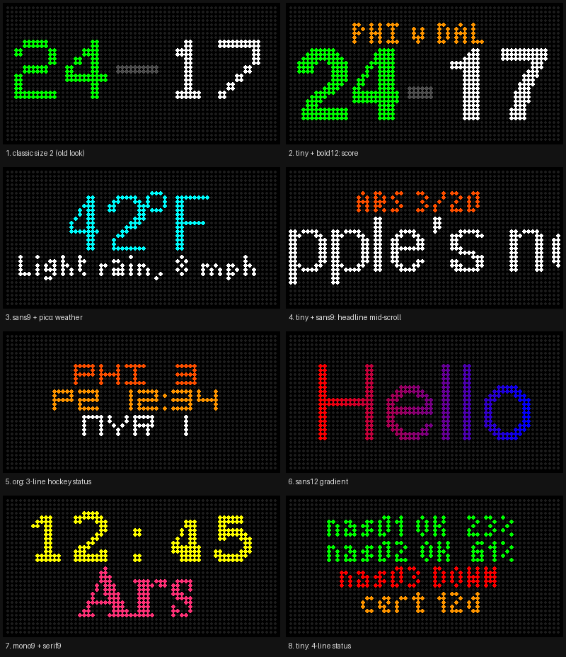
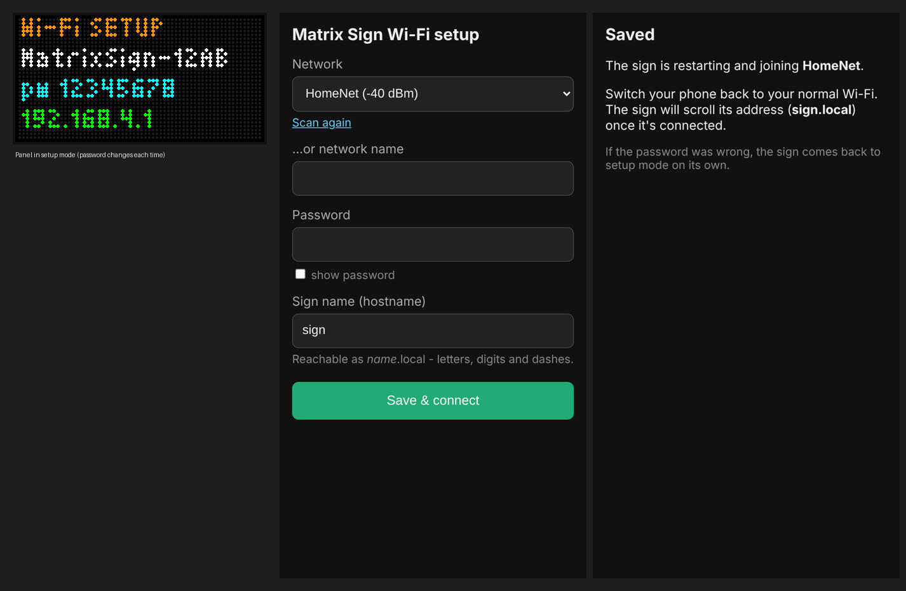
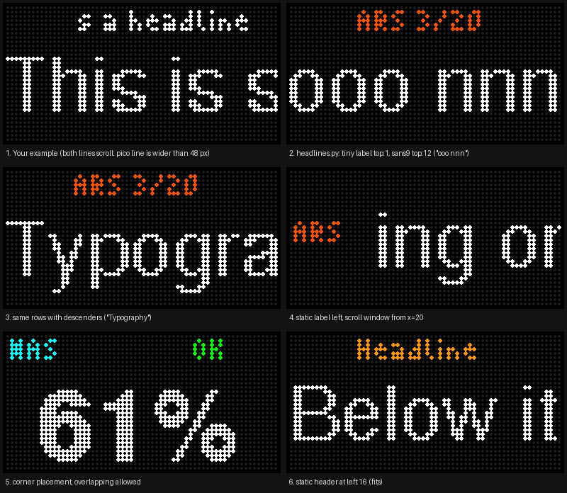
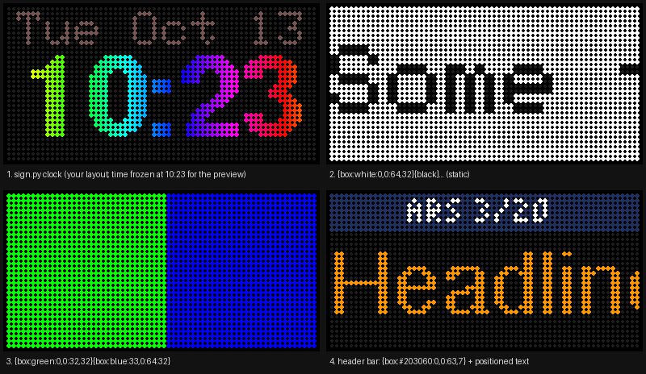

# MatrixSign

A Wi-Fi LED message sign built from an **ESP32-S3** and a **64×32 HUB75 RGB LED panel**.
Send it text, colors, images or animated GIFs from any computer on your network with one
UDP packet, or let it run a clock on its own.

- Rainbow, wave, gradient, pulse and blink color effects, mixed freely in one message
- Smooth proportional fonts (FreeSans, Bold, Mono, Serif, plus tiny pixel fonts), up to 4 lines
- Pixel-exact placement (`{top:}`, `{left:}`), background boxes, scroll-once or loop
- Images and animated GIFs (resized and gamma-corrected for LEDs)
- A built-in clock with NTP time sync and automatic daylight saving time
- Phone-based Wi-Fi setup: no passwords in the code
- A small Python CLI (`sign.py`) plus examples: RSS headline ticker, live sports scoreboard



---

## Contents

1. [Hardware](#hardware)
2. [Wiring and power](#wiring-and-power) ← read this before powering up
3. [Install the Arduino IDE, board support and libraries](#install-the-arduino-ide-board-support-and-libraries)
4. [Configure and upload the sketch](#configure-and-upload-the-sketch)
5. [First boot: Wi-Fi setup from your phone](#first-boot-wi-fi-setup-from-your-phone)
6. [Install the command-line tools](#install-the-command-line-tools)
7. [Using it](#using-it)
8. [Examples](#examples)
9. [Troubleshooting](#troubleshooting)
10. [Repository layout](#repository-layout)

---

## Hardware

| Part | Notes |
|---|---|
| **ESP32-S3-DevKitC-1** | Any memory variant (N8, N8R8, N16R8…). PSRAM isn't used. Has two USB-C ports, labeled **UART** and **USB**. |
| **Seengreat RGB Matrix Adapter Board (E)** | Carrier board: the DevKit plugs in, the panel's HUB75 ribbon plugs in, and it distributes 5 V power. [Seengreat wiki](https://seengreat.com/wiki/186). Pinouts for both the **V2.x** board (default) and **V1.x** are in the sketch. |
| **HUB75 RGB LED panel, 64×32** | Tested with a P2.5 / P3 64×32 1/16-scan panel. 64×64 panels work with a one-line change (`PANEL_RES_Y 64`). |
| **5 V power supply, 4 A or more** | A 64×32 panel can draw 2–3 A at full white. Use the adapter's **DC-044 barrel jack** (rated 5 V / 8 A) rather than its Type-C input. |
| **A USB-C power lead for the DevKit** | Feeds the DevKit's second USB-C port from the same 5 V supply. See below. It's what makes the sign stable. |
| *(optional)* 1000 µF / 10 V capacitor | Across 5 V and GND near the DevKit; extra margin against supply dips. |
| A USB-C data cable | For programming from your computer. |

---

## Wiring and power

```
                  5 V / 4 A+ supply
                        │
                        ▼  (DC-044 barrel jack)
   ┌──────────────── Seengreat adapter (E) ────────────────┐
   │  VH-4P out #1 ──────────────► panel power lead       │
   │  VH-4P out #2 ──────────────► USB-C power lead ──┐    │
   │  HUB75 out ─────────────────► panel ribbon        │    │
   │  [ ESP32-S3-DevKitC-1 plugged into the socket ]   │    │
   │        UART port ◄── USB cable to your computer   │    │
   │        USB  port ◄────────────────────────────────┘    │
   └────────────────────────────────────────────────────────┘
```

1. **Plug the DevKit into the adapter**, matching the board outline on the silkscreen.
2. **Connect the panel's HUB75 ribbon** to the adapter's HUB75 connector and the panel's **input** connector (the arrows on the back of the panel point away from the input).
3. **Connect the panel's power lead** to one of the adapter's two **VH-4P (3.96 mm) 5 V outputs**. Check the 5 V / GND markings, because reversed polarity will damage the panel.
4. **Power the DevKit separately through its second USB-C port.** ⚠️ This is the important one.

### Why the DevKit needs its own power lead

With the DevKit powered only through the adapter's header pins, everything works until Wi-Fi turns on.
Then the panel shows **random "ghost" blinks**: rows of pixels briefly flash a few rows away from
where they belong. The ESP32's radio draws sharp current spikes when it transmits. Through the
header path, those spikes dip the DevKit's supply just enough to corrupt the panel's row-select
signals for an instant.

The fix that works: give the DevKit its own feed into one of its **USB-C** connectors. I made
a short lead from the adapter's **spare VH-4P 5 V output** (the second panel power connector) to
a USB-C plug, so the DevKit and the panel run from the same supply but the DevKit gets a clean,
direct path. Plug it into the DevKit's USB-C port that you **don't** use for programming, and keep
the other port for your computer.

- Use a USB-C plug or pigtail with **5 V (VBUS) and GND only**. Red = 5 V and black = GND on most leads, but **check with a meter**.
- The supply's ground and the DevKit's ground are already common through the adapter.
- The **`WIFI_TX_POWER`** setting in the sketch (reduced transmit power) helps too. It's on by default.

> **Flashing while powered:** with the power lead in one port and your computer in the other,
> the computer's USB 5 V and your supply are connected through the DevKit. That's how this
> sign is used and it's been fine, but if you'd rather avoid it, unplug the power lead while
> flashing, or use a USB "power-blocker" (data-only) adapter on the computer side.

Seengreat also recommends: **don't plug or unplug anything while powered**, and check polarity before switching on.

---

## Install the Arduino IDE, board support and libraries

### 1. Arduino IDE

Install **Arduino IDE 2.x** from <https://www.arduino.cc/en/software>.

### 2. ESP32 board support

1. **File → Preferences → Additional boards manager URLs**, add:
   ```
   https://espressif.github.io/arduino-esp32/package_esp32_index.json
   ```
2. **Tools → Board → Boards Manager**, search **esp32**, and install **"esp32 by Espressif Systems"** (version **3.x**).

### 3. Libraries

**Tools → Manage Libraries** (or **Sketch → Include Library → Manage Libraries**), then install:

| Library | Author | Why |
|---|---|---|
| **ESP32 HUB75 LED MATRIX PANEL DMA Display** | mrcodetastic (Faptastic) | Drives the panel with DMA |
| **Adafruit GFX Library** | Adafruit | Text and fonts. Accept its dependency **Adafruit BusIO** when asked. |

Everything else (Wi-Fi, web server, captive-portal DNS, flash storage, mDNS, NTP) is part of the
ESP32 core. The fonts ship with Adafruit GFX.

---

## Configure and upload the sketch

### 1. Get the code

```bash
git clone https://github.com/spandox2/matrix-sign.git
```

Open **`MatrixSign/MatrixSign.ino`** in the Arduino IDE. Keep `MatrixSign.ino` and `SignTypes.h`
together in the `MatrixSign` folder; the IDE needs the folder name to match the `.ino`. Both should
appear as tabs.

### 2. Check the settings at the top of `MatrixSign.ino`

| Setting | Default | Change it if… |
|---|---|---|
| `PANEL_RES_X` / `PANEL_RES_Y` | `64` / `32` | You have a 64×64 panel (`PANEL_RES_Y 64`) |
| `PANEL_CHAIN` | `1` | You chain several panels |
| `ADAPTER_V2` | defined | Your adapter says **V1.x**: comment the line out |
| `HOSTNAME` | `"sign"` | You want a different default name (it can also be changed on the setup page) |
| `TZ_INFO` | US Eastern | Default timezone for the clock. `sign.py clock` sends your computer's zone anyway. |
| `DEFAULT_BRIGHT` | `80` | Startup brightness, 0–255 |
| `WIFI_TX_POWER` | `WIFI_POWER_8_5dBm` | Leave it reduced unless the sign is far from the router |

### 3. Board settings (Tools menu)

| Setting | Value |
|---|---|
| **Board** | **ESP32S3 Dev Module** |
| **Port** | The COM / tty port of the DevKit's **UART** USB-C port |
| **PSRAM** | **Disabled** (not needed). If you're on a V1.x adapter with an octal-PSRAM module, it **must** be disabled, because V1.x uses GPIO 35–37. |
| **USB CDC On Boot** | Disabled (default), since the Serial Monitor uses the UART port |
| **Upload Speed** | 921600 (drop to 115200 if uploads fail) |
| **Erase All Flash Before Sketch Upload** | Disabled. Enabling it also erases the saved Wi-Fi settings. |
| Everything else | Defaults |

### 4. Upload

Click **Upload**. If it stops at `Connecting......` with *"No serial data received"*:

1. Hold **BOOT**, tap **RST**, keep holding BOOT, and click Upload again. Let go once it says `Writing at…`.
2. On a **V1.x** adapter, GPIO0 (the boot pin) is wired to the panel, so pull the DevKit out of the adapter to upload.
3. Make sure no other program (Serial Monitor, PuTTY) has the port open.

Open **Tools → Serial Monitor** at **115200** baud to watch it start:

```
[boot] display ok
[boot] reset reason: power-on (1)
[boot] saved network: '', name: sign
[setup] starting setup mode
[setup] radio on
[setup] scan found 9 networks
[setup] access point up: MatrixSign-1A2B
[setup] web server running
```

---

## First boot: Wi-Fi setup from your phone



There are no Wi-Fi credentials in the code. On first boot, or whenever its saved network can't be
found, the sign starts **setup mode** and shows on the panel:

```
Wi-Fi SETUP
MatrixSign-XXXX        <- its own network
pw 12345678            <- password (new random digits every time)
192.168.4.1
```

1. On your phone, join **MatrixSign-XXXX** with that password.
2. The setup page opens by itself on most phones. If not, browse to **http://192.168.4.1**.
3. Pick your network (strongest first) or type its name, enter the password, and optionally change the
   **sign name** (default `sign`, so the sign answers as `sign.local`).
4. Tap **Save & connect**. The sign restarts, joins your Wi-Fi and scrolls its address:
   `sign.local 192.168.x.x:4210`.

| Later… | What happens |
|---|---|
| Power cut, and the router comes back slower than the sign | The sign starts setup mode **and** retries the saved network every minute (while no phone is connected to it), then goes back to normal on its own. |
| Wrong password typed | The join fails and it comes back to setup mode. |
| Move it to a different network | `sign.py setup` reboots it into setup mode. If nobody completes setup within 10 minutes, it returns to the old network. |
| Wipe the saved network | Hold the DevKit's **BOOT** button for **5 seconds** (V2 adapter only; on V1.x GPIO0 drives the panel). |

Settings live in flash and survive re-uploading the sketch.

---

## Install the command-line tools

The tools are in `tools/` and need **Python 3.8+**.

```bash
cd matrix-sign/tools
chmod +x sign.py headlines.py
./sign.py text "{wave}Hello!"
```

| Need | Install |
|---|---|
| Text, clock, headlines | Nothing extra (standard library only) |
| `image` / `gif` commands | **Pillow**: `sudo apt install python3-pil` (Debian/Ubuntu/RPi OS), `sudo dnf install python3-pillow` (Fedora/RHEL), or `pip install pillow` (version 9.1 or newer) |
| `examples/scoreboard.sh` | `curl` and `jq` |

**Finding the sign:** the tools default to `--host sign.local`.

- **Linux:** `sign.local` resolves if `avahi-daemon` and `libnss-mdns` are installed (most desktop distros have them).
- **macOS and Windows 10+:** `sign.local` resolves out of the box.
- **Otherwise:** pass `--host 192.168.x.x`, or add a line to `/etc/hosts`.

Optional: put `tools/` on your `PATH`, or symlink `sign.py` into `~/bin`.

---

## Using it

The sign always shows **the last thing it received**. Full reference: **[docs/SIGN.md](docs/SIGN.md)**.

```bash
# Text with color tags and effects
./sign.py text "{red}DISK 92%{/} on {cyan}nas01"
./sign.py text "{wave}Hello world" --scroll --speed 40
./sign.py text "{grad:#FF0000:#0000FF}gradient {pulse:red}ALERT {blink:amber}!"

# Fonts and multiple lines (\n = new line)
./sign.py text "{font:tiny}{amber}PHI v DAL\n{font:bold12}{green}24{gray}-{white}17"

# Pinned layout that never shifts
./sign.py text "{top:1}{font:tiny}{orange}ARS 3/20\n{top:12}{font:sans9}Headline text..." --once

# Background boxes
./sign.py text --static "{box:white:0,0:64,32}{black}INVERT"

# Images and GIFs
./sign.py image photo.jpg
./sign.py image sprite.png --nearest
./sign.py gif nyan.gif

# Clock kept by the sign (NTP + your timezone)
./sign.py clock
./sign.py clock --12h

# Housekeeping
./sign.py bright 30
./sign.py clear
./sign.py setup          # back into Wi-Fi setup mode
```

No Python handy? It's plain UDP:

```bash
echo '{green}Build passed' | nc -u -w1 sign.local 4210
```

### Fonts

`classic` (default 5×7 blocks), `tiny`, `pico`, `org`, `sans9/12/18/24`, `bold9/12/18/24`,
`mono9/12`, `serif9/12`. On a 64×32 panel, `bold12` is the biggest font that fits a 5-character score.
See the [Fonts table](docs/SIGN.md#fonts) for sizes.

### Placement, boxes and the clock





---

## Examples

| Script | What it does |
|---|---|
| `tools/headlines.py` | Scrolls RSS/Atom headlines one at a time (default: Ars Technica). Each headline scrolls through once, then the next one starts. `./headlines.py --font sans9 --label-font tiny` |
| `examples/scoreboard.sh` | Live score + period/clock/FINAL from ESPN for NFL, NHL, NBA or MLB: `./scoreboard.sh nfl PHI green`, `./scoreboard.sh nhl PHI orange` |
| `examples/clock-on-boot.sh` | Puts the sign back on its clock. Handy in cron after other scripts. |

Cron example: Eagles score every minute on Sundays, otherwise the clock every 30 minutes:

```cron
* * * * 0     ~/matrix-sign/examples/scoreboard.sh nfl PHI green
*/30 * * * 1-6 ~/matrix-sign/examples/clock-on-boot.sh
```

---

## Troubleshooting

| Symptom | Fix |
|---|---|
| Upload fails at `Connecting...` | BOOT + RST method above; on a V1.x adapter, pull the DevKit out to upload; try 115200 upload speed. |
| Image is garbled, shifted or doubled | Wrong adapter version: toggle `ADAPTER_V2`. If it's still wrong, set `cfg.clkphase = true` in `setup()`. |
| Only half the panel lights up (64×64) | Set `PANEL_RES_Y 64`. |
| Random blinks / ghost rows, worse with Wi-Fi on | Power. Give the DevKit its own USB-C power lead ([Wiring and power](#wiring-and-power)), add a 1000 µF cap, and use a 4 A+ supply on the barrel jack. |
| Panel blank, no setup network | Check the Serial Monitor. `BROWNOUT` = power problem. `crash (panic)` = open an issue with the log lines (`Guru Meditation`/`assert` + `Backtrace`). |
| Setup page doesn't pop up | Browse to `http://192.168.4.1` while joined to the `MatrixSign-XXXX` network. Some phones also ask whether to "stay connected" to a network without internet: say yes. |
| `sign.local` doesn't resolve | Use `--host <ip>` (the IP is shown when the sign connects), or install avahi/libnss-mdns, or add it to `/etc/hosts`. |
| `ModuleNotFoundError: No module named 'PIL'` | Install Pillow (see above). Only needed for images and GIFs. |
| Scroll repeats or overlaps | Use `--once` (each pass scrolls once), or a larger `--gap`. |
| Clock shows "syncing time..." | Waiting for NTP. The sign needs internet access to `pool.ntp.org`. |
| Clock is off by hours | Run `sign.py clock` from a machine with the right timezone, or pass `--tz` (POSIX format, e.g. `CST6CDT,M3.2.0,M11.1.0`). |

---

## Repository layout

```
matrix-sign/
├── MatrixSign/
│   ├── MatrixSign.ino     # firmware (open this in the Arduino IDE)
│   └── SignTypes.h        # shared types (must sit next to the .ino)
├── tools/
│   ├── sign.py            # command-line sender
│   └── headlines.py       # RSS headline ticker (uses sign.py)
├── examples/
│   ├── scoreboard.sh      # live sports scores from ESPN
│   └── clock-on-boot.sh
└── docs/
    ├── SIGN.md            # full reference: tags, fonts, placement, clock, protocol
    └── images/
```

## Credits

- Panel driver: [ESP32-HUB75-MatrixPanel-DMA](https://github.com/mrcodetastic/ESP32-HUB75-MatrixPanel-DMA) by mrcodetastic
- Graphics and fonts: [Adafruit GFX Library](https://github.com/adafruit/Adafruit-GFX-Library)
- Adapter board: [Seengreat RGB Matrix Adapter Board (E)](https://seengreat.com/wiki/186)
